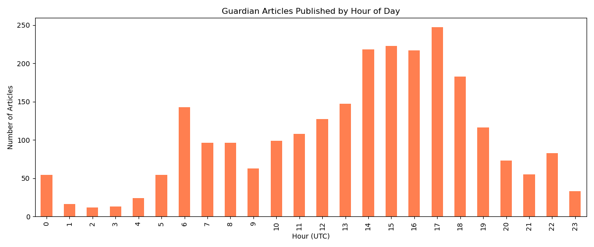
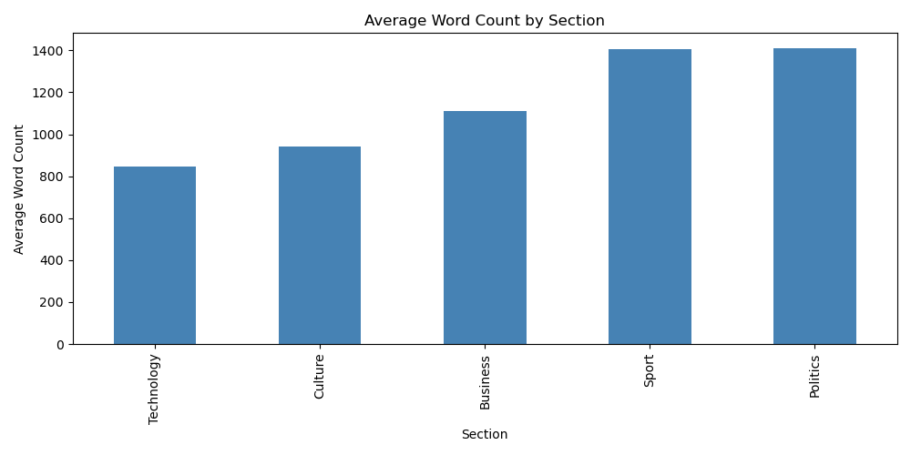
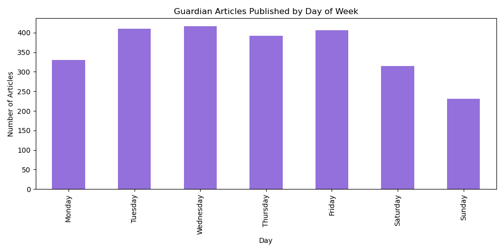

# Guardian Content Performance Dashboard

## Project Overview
An analytical dashboard examining editorial patterns across 2,500 Guardian articles, 
spanning Technology, Business, Sport, Culture, and Politics sections.

Built to demonstrate real-world content analytics skills using Python and data visualisation.

## Business Questions Answered
- When does The Guardian publish most — and why does timing matter for audience reach?
- Which sections produce the longest, most in-depth content?
- How does publishing volume vary across the working week?

## Key Findings
- **Peak publishing window is 13:00–17:00 UTC** — aligning with UK afternoon commute audience behaviour
- **Politics and Sport produce the longest articles** (avg 1,400+ words) while Technology runs shortest (avg 848 words)
- **Weekday publishing dominates** — Sunday output is nearly half that of peak weekday days
- **Tuesday, Wednesday and Friday are the highest volume days** suggesting deliberate mid-week editorial scheduling

## Charts

### Publishing Hours

### Word Count by Section

### Publishing by Day of Week

## Tools Used
- Python (pandas, matplotlib, requests)
- Guardian Open Platform API
- VS Code

## Files
- `fetch_guardian.py` — data collection script
- `analyse_guardian.py` — analysis and visualisation script
- `guardian_articles.csv` — raw dataset (2,500 articles)

## Skills Demonstrated
- API integration and automated data collection
- Data cleaning and transformation with pandas
- Exploratory data analysis
- Data visualisation with matplotlib
- Editorial insight generation from raw content data